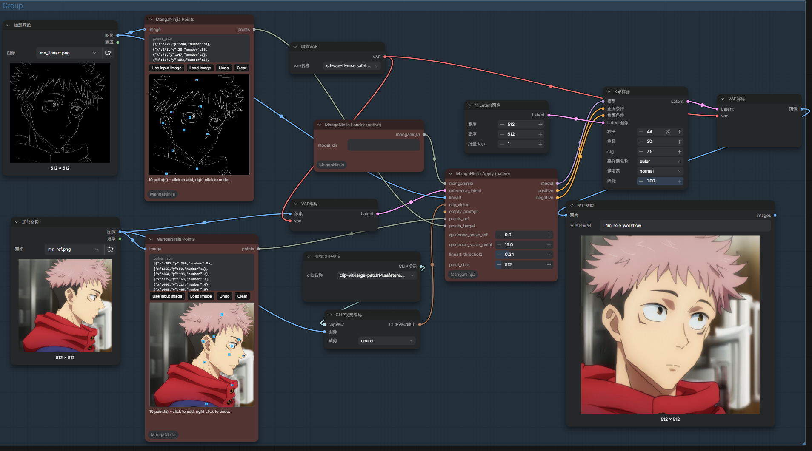

# ComfyUI_MangaNinjia

[MangaNinjia](https://github.com/ali-vilab/MangaNinjia)：线稿上色 + 精确参考跟随。
---

# Update
* 重新封装MangaNinjia，支持最新的UI/ rewrite MangaNinjia for the latest UI
* 直接把 `lineart` 输入当灰度线稿处理；若输入是彩色图，请先在 ComfyUI 里接任意线稿/边缘预处理器节点（如 ControlNet Aux 的 LineArt）再送进来。/ Directly treat the `lineart` input as a grayscale lineart; if the input is a color image, please preprocess it with any lineart/edge node in ComfyUI (e.g. ControlNet Aux's LineArt) first.

# Installation

In the ./ComfyUI/custom_nodes directory, run the following:   
```
git clone https://github.com/smthemex/ComfyUI_MangaNinjia.git
```
---

# Models
* sd1.5 vae [address](https://modelscope.cn/models/AI-ModelScope/stable-diffusion-v1-5/files) 
* MangaNinjia [address](https://huggingface.co/Johanan0528/MangaNinjia/tree/main)  
* clipvison  [address](https://huggingface.co/openai/clip-vit-large-patch14/tree/main) #clip-vit-large-patch14 

```
ComfyUI/models/
├─ vae/
│   ├─sd-vae-ft-mse.safetensors   # sd1.5 vae
├─ MangaNinjia/
│   ├─ denoising_unet.pth      # 主 UNet（MangaNinjia 微调权重）
│   ├─ reference_unet.pth      # 参考 UNet
│   ├─ controlnet.pth          # 线稿 ControlNet
│   └─ point_net.pth           # 点引导卷积塔
└─ clip_vision/
│   ├─clip-vit-large-patch14.safetensors   
```

# Example


# Citation

```
@article{liu2025manganinja,
  title={MangaNinja: Line Art Colorization with Precise Reference Following},
  author={Liu, Zhiheng and Cheng, Ka Leong and Chen, Xi and Xiao, Jie and Ouyang, Hao and Zhu, Kai and Liu, Yu and Shen, Yujun and Chen, Qifeng and Luo, Ping},
  journal={arXiv preprint arXiv:2501.08332}, year={2025}
}
```
